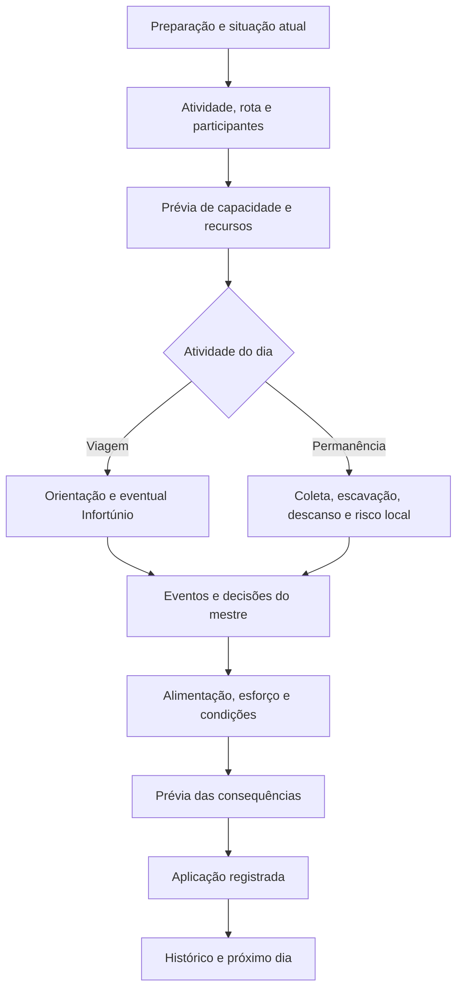

# Plano de automação das expedições

Proposta de implementação de 15/10/2026, baseada nos PDFs da mesa e no código do Ind Resources. O estudo inicial entregou documentação e diagnóstico. As etapas A e B estão implementadas localmente, com aceitação em runtime pendente; as etapas C–F continuam futuras. Consulte os registros de [orientação e privacidade](EXPEDICOES-ETAPA-A-ORIENTACAO-E-PRIVACIDADE.md) e [jornada, esforço e eventos](EXPEDICOES-ETAPA-B-JORNADA-E-EVENTOS.md). A entrega B de 16/10/2026 não altera versão, IDs, UUIDs ou bancos distribuídos de compêndio.

Fontes: [regras e referências](EXPEDICOES-REGRAS-E-FONTES.md). Evidências e prioridades: [auditoria de conformidade](EXPEDICOES-AUDITORIA-DE-CONFORMIDADE.md).

## Resultado pretendido

A ficha de Grupo deve acompanhar preparação, jornada, permanência, escavação e retorno. Para cada dia, deve mostrar as decisões relevantes, explicar os modificadores, resolver os componentes escolhidos e registrar o que efetivamente foi aplicado. O mestre pode preparar eventos em segredo, selecionar resultados e decidir como as ocorrências se conectam.

Uma expedição precisa conservar riscos e escolhas: abastecer-se ou andar; prosseguir ou desviar; fazer fogo para aquecer-se; abandonar carga ou arriscar a marcha; continuar escavando ou retornar. A automação calcula e registra as consequências acordadas, sem substituir essas decisões por um botão que avance tudo sem contexto.

## 1. Perfil de regras e limites

Usar como referência inicial o procedimento do **Guia do Mestre PT-BR consultado**. Registrar sua identificação e as opções efetivamente adotadas na expedição. Isso é procedência das regras, não uma nova seleção de sistema.

- Aproveitar `enableRations`, `enableHunger`, carga, cura e demais configurações existentes.
- Não criar uma segunda configuração para opções nativas do Symbaroum, como críticos e sucesso automático no 1.
- Identificar separadamente Fome, procura ativa e sobrecarga como regras opcionais.
- Preservar valores personalizados de alimentos, carga, tabelas e transportes. Uma classificação como regra da mesa deve manter o valor, não substituí-lo automaticamente.
- Considerar o modificador de rio do GM PT-BR p.97: +2 em Terreno. Outra edição só deve ser incorporada depois de conferida e identificada.
- Não introduzir calendário de clima, consumo de lenha, turnos de vigília ou testes universais de acampamento como se fossem exigências do livro.

As ambiguidades documentadas não devem travar as correções inequívocas. Onde uma consequência depender de interpretação, exibir o contexto e permitir ao mestre registrar a resolução daquela situação. Uma decisão persistente de regra própria deve ficar identificada como tal.

## 2. Fluxo diário proposto

O diagrama é uma organização de interface, **não uma ordem universal acrescentada às regras**. O GM pode preparar eventos antes da sessão. Efeitos que mudem o dia obrigam a recalcular a prévia antes da aplicação; uma ocorrência pode interromper a sequência e gerar novas decisões.

### Preparar o dia

Definir região real, trecho da rota, curso d'água, deslocamento a pé/montado, ritmo, procura ativa, participantes e papéis. Registrar quem precisa comer/beber, quem pode pastar, quem está ausente e quais condições persistem.

As atividades devem refletir decisões concretas: viajar, permanecer, coletar em dedicação exclusiva, escavar e descansar. Uma pessoa não pode receber automaticamente o resultado de coleta sem movimento e também ser registrada como viajando normalmente no mesmo período. O tratamento de uma equipe que se separa precisa ser explícito.

### Resolver e aplicar

Mostrar a decomposição: valor do atributo, nível de Mateiro, penalidade regional, informação, benefícios, chances adicionais e condições. Depois distinguir resultado, proposta de consequência e aplicação já realizada.

Uma operação aplicada não deve ser repetida por fechar/reabrir a ficha, receber outro socket, renderizar o chat ou clicar duas vezes. Correções administrativas do contador não podem fingir que reverteram consumos e ferimentos anteriores.

## 3. Estado necessário

Conservar o esquema atual e adicionar apenas campos necessários a cada etapa. Os nomes abaixo são conceituais e devem ser ajustados ao menor patch compatível:

| Escopo | Conteúdo |
|---|---|
| Expedição | Perfil de regras, participantes/papéis, origem/destino, configuração de rota e atividades |
| Trecho | Região real, curso d'água, distância prevista, progresso confirmado e impedimentos |
| Dia | ID/revisão estável, atividade, orientação, coleta, eventos, alimentação, esforço e decisões pendentes |
| Condições persistentes | Perdido, animais doentes, chuvarada, contaminação, déficits alimentares e corrupção com duração especial |
| Local/ruína | Identidade do local, região, atributos relevantes, capacidade de achados e saldo remanescente |
| Histórico | Intenção autenticada, documentos afetados, resultado aplicado, recibos e eventual compensação |
| Dados restritos | Resultados secretos e capacidade oculta da ruína, fora da cópia compartilhada acessível no Grupo |

O `dayState` não deve carregar sozinho tudo que sobrevive ao dia. As leituras legadas de `system` e flags continuam válidas durante a migração. Não executar migração ou gravação em renderizações.

**Privacidade:** adotar mecanismos nativos de documento/mensagem com controle efetivo de visibilidade, armazenar no Grupo apenas o resumo permitido e uma referência. Validar o que um cliente sem autorização recebe, inclusive flags e sockets. Ocultar a seção visual não basta. Bônus derivados também podem revelar um resultado secreto; a política de resumo deve considerar isso. Reutilizar os modos público, privado, cego e autor do core.

## 4. Etapas de implementação

### Etapa A — corrigir orientação e procedência

**Implementada no código; validação interativa pendente.** Abrange E01/E02/E03/E06/E07, C05/C06 e parte das referências E22/E23. E04/E05 continuam nas etapas B/C. As limitações de efeitos personalizados, política de Fome e dados legados estão no [registro da entrega](EXPEDICOES-ETAPA-A-ORIENTACAO-E-PRIVACIDADE.md).

1. Separar elegibilidade, teste para evitar Infortúnio e direito aos benefícios dos eventos.
2. Impedir o procedimento sem Mateiro I; níveis insuficientes continuam podendo evitar Infortúnio com a penalidade correta, sem bônus normais.
3. Calcular a melhoria de -1 para -2 pela margem mínima de cinco, independentemente do rótulo de crítico.
4. Compor Cartógrafo, Desbravador, Dedo Verde, informação e Fome com o atributo preparado pelo sistema. Identificar os efeitos já incluídos para não duplicá-los.
5. Conferir as opções nativas de 1/20 e a API pública de testes do sistema antes de escolher o adaptador. A operação deve obter rolagem, sucesso, margem e chances adicionais sem publicar uma segunda mensagem.
   Modificadores de itens e tesouros são contextuais: orientação, rastreamento e detecção não podem compartilhar automaticamente todos os mesmos bônus (GM pp.101–102).
6. Preservar o executor GM já implementado, a propriedade do guia e a revisão do dia. Incluir região e configuração relevante na validação de resultado atrasado.
7. Corrigir referências de páginas e nome de Infortúnios, mantendo os IDs de tabela existentes e reconhecendo os IDs históricos.
8. Resolver o armazenamento restrito antes de ampliar a exposição de resultados e históricos na ficha.

**Aceitação:** matriz dos três níveis nas três regiões, nível zero, margens 4/5, natural 1, alvo fora de 1–19 com opções nativas ligadas/desligadas, Fome, Desbravador e bônus já preparados. Dono apenas do guia funciona; outros jogadores não podem enviar resultado ou patch arbitrário. Nenhum dado restrito aparece em um cliente não autorizado.

### Etapa B — ligar rota, procura ativa e eventos

**Implementada localmente em 16/10/2026; validação interativa pendente.** Abrange C07/C10, E04, E10/E11 e parte de E16/E17. Regras, políticas explícitas, limites e validações constam no [registro da etapa B](EXPEDICOES-ETAPA-B-JORNADA-E-EVENTOS.md). A próxima etapa de implementação é C.

1. Compartilhar um contexto de viagem entre Grupo e régua, mantendo a régua tática isolada das mudanças de expedição.
2. Separar região real, coluna usada para velocidade e dificuldade do esforço. Viajar por rio não reduz Mateiro ou risco regional.
3. Aplicar o +2 de rio a Terreno no perfil PT-BR e mostrar sua origem.
4. Vincular procura ativa ao limite de velocidade, quando essa opção estiver adotada. Mudar o ritmo deve atualizar a prévia imediatamente.
5. Aplicar Fome à estimativa e resolver esforço de sobrecarga sem aumentar acidentalmente a distância. O ritmo do grupo precisa de participantes e impedimentos conhecidos; não inferir tudo do tipo do token.
6. Resolver as consequências diárias de marcha forçada/mortal e a exceção de Marcha Duradoura. O resultado 20 recebe o tratamento explicitado para o perfil, com aplicação consciente pelo mestre.
7. Manter quatro resultados independentes, aceitando escolha manual do GM. Antes da aplicação, revalidar os parâmetros de eventuais resultados preparados antecipadamente.
8. Criar a ação de detecção com melhor Vigilante elegível, modificador da linha e opções após sucesso. Não converter habilitação em sucesso automático.
9. Adicionar permanência, contagem de dias no local e o teste do maior Discreto desde o segundo dia, sem desconto de orientação no resultado devido à falha.

**Aceitação:** todas as 18 velocidades; rio nas três regiões; marcha forçada com/sem Marcha Duradoura; esforço sobrecarregado; comida/Fome mudando entre dias; procura ativa recusada/ajustada no ritmo rápido; detecção com todos os modificadores da tabela; permanência no primeiro e segundo dias. Os casos em que o livro deixa a combinação aberta devem exibir a política adotada.

### Etapa C — abastecimento e condição alimentar

Corrige C09 e E05/E08/E09/E13–E15/E26.

1. Diferenciar pão semanal, ração ordinária, provisão coletada e alimento configurado pela mesa. Introduzir classificação explícita com fallback compatível, sem converter inventários existentes por suposição de nome.
2. Expressar quantidade disponível em rações diárias para a expedição e conservar a quantidade física e usos parciais do inventário. Uma ração perdida não é necessariamente um item inteiro perdido.
3. Garantir os pesos específicos de pão e ração ordinária, respeitando flags manuais e regras personalizadas. Não recalcular toda a base de equipamentos no mesmo patch.
4. Resolver coleta com Vigilante/Mateiro: 1d6 viajando e 1d10 em dedicação exclusiva, quando bem-sucedida e elegível. Mostrar destino e origem do abastecimento.
5. Definir necessidades por participante. Não excluir um PNJ humano porque seu ator é `monster`, nem exigir comida de uma criatura que não se alimenta.
6. Registrar alimentação por participante e período, comum à ficha do Grupo, inventário pessoal e descanso. Consumos para amanhã não podem ser bloqueados por um recibo de hoje.
7. Oferecer alimentação normal, reduzida ou ausente conforme a política escolhida. Registrar dias deficitários e apresentar a entrada em Fome; não presumir que metade de qualquer item gastronômico seja a quantidade oficial de racionamento.
8. Resolver a inanição e recuperação no calendário diário. A recuperação de Vigoroso após Fome deve usar a regra explicitada ou continuar identificada como adaptação; não copiar automaticamente o procedimento de doença.
9. Manter água fresca como pressuposto normal do capítulo. Se um evento interromper esse acesso, registrar indisponibilidade/contaminação e apresentar desidratação; não impor um sistema novo de litros sem opção da mesa.

**Aceitação:** sete pessoas-dia por pão, uma por provisão ordinária; pesos 1/0,5; usos parciais; alimentos mistos; pilhas distintas; perda de 1d20 rações; personagem já alimentado por outro caminho; recipiente e ator sintético; estoque suficiente/insuficiente; limpeza de itens ligada/desligada; cinco dias sem comida e o cenário separado de alimentação reduzida conforme política; mundo recarregado sem duplicar débitos.

### Etapa D — consequências persistentes e natureza corrompida

Completa E18/E19/E21, incluindo os casos em que descanso não pode limpar corrupção.

1. Implementar um incidente por patch, começando pelos de regra mais objetiva: Comida Estragada, Chuvarada, Perdido e Animais Doentes.
2. Cada incidente produz decisões/testes e uma proposta de alterações, com origem e condição de término.
3. Implementar escolhas de desvio, perda em quilômetros, fração de dia e dano dos demais incidentes mensuráveis. Preservar o texto e a condução do mestre para os narrativos.
4. Encadear De Mal a Pior e Covil do Mal. Limites técnicos de recursão devem interromper e pedir condução do GM; não rerrolar silenciosamente para evitar um resultado difícil de implementar.
5. Contaminação registra quais provisões e participantes foram afetados, permitindo distinguir estoque novo e limpo. Se o modelo agregado legado não comportar essa distinção, adicionar os dados de origem necessários antes de debitar.
6. Corrupção com remoção por saída da área ou semana de comida pura deve persistir. O descanso comum não zera essas parcelas.
7. Para natureza corrompida, realizar exatamente 1/3/5 consultas à Tabela 2 do CM, controlando repetição e o limite de uma Corrupção Virulenta.
8. Oferecer percepção, compreensão, desvio, proteções rituais e lista de ameaças em ondas. O mestre decide composição e criação dos tokens; nenhum resultado deve iniciar automaticamente combate para os jogadores.
9. Doenças são uma integração posterior específica com CM p.169, mantendo seus próprios testes, recuperação e tratamentos. Não reutilizar o algoritmo de Fome indiscriminadamente.

**Aceitação:** Perdido atravessa vários dias e termina após três sucessos; chuvarada só termina na condição adequada; um animal ainda doente mantém o impedimento; ração contaminada conserva origem; dormir não limpa corrupção retida; natureza com resultados repetidos e duas entradas virulentas; proteção por Cantiga da Natureza; prevenção de dupla aplicação e respeito a valores já modificados por outros módulos.

### Etapa E — ruínas, escavação e saque

Completa E20 e torna útil permanecer em um local.

1. Criar ou vincular um registro persistente de ruína a partir da descoberta, sem gerar um mapa ou aventura completa obrigatoriamente.
2. Sortear a capacidade de achados uma única vez. Manter a opção de o GM ocultá-la.
3. Registrar participantes e um teste de Vigilante por pessoa/dia, aplicando eventuais traços de riqueza/escassez de tesouros.
4. Gerar a categoria na Tabela 30 segundo a região e encaminhar ao conteúdo correspondente das tabelas 31–33, com consulta manual quando a fonte não estiver disponível.
5. Nunca conceder mais achados que a capacidade restante; sucessos simultâneos compartilham a mesma fila do local.
6. Diferenciar achado, retirada, carga transportada e venda. Avaliação de valor não cria dinheiro automaticamente.
7. Permitir a busca de ruína específica por pesquisa e Astuto como procedimento distinto da Tabela 26 diária.
8. Oferecer o gerador do capítulo 13 como extensão posterior: propósito, níveis, traços, habitantes, relações e salas. Isso não deve atrasar a estabilização do ciclo de viagem.

**Aceitação:** limite secreto persiste após recarregar; dois escavadores disputam o último achado sem duplicação; dia de escavação consome recursos e pode gerar risco de permanência; abandonar e revisitar conserva o saldo; local já saqueado não ganha capacidade nova; valor sugerido não é depositado como moeda.

### Etapa F — preparação e retorno

Adicionar depois do núcleo diário: registro de informação regional/pesquisa, custo previsto do guia, carregadores, licença, financiadores, participações, salários e retorno com carga. Aproveitar o serviço de moedas existente, mas separar previsão e débito efetivo.

Contratos, barganhas, lealdade, suborno, facções, venda de artefatos e decisão de abandonar carga continuam mediadas pelo mestre. Capacidades de veículos sem referência devem ficar como valores editáveis do módulo/mesa, e não como verdades oficiais.

## 5. Integração técnica e proteção dos dados

### Aproveitar os serviços existentes

| Existente | Papel na evolução |
|---|---|
| `PartyActorSheet` | Exibir contexto e encaminhar intenções; evitar duplicar regras em handlers de botões |
| `PartyActorService` / sockets | Autoridade autenticada; autorização por ação; cálculo no executor |
| `expedition-state.mjs` | Leitura legada, revisão do dia e fila de operações |
| `RationService` | Débito/consolidação de estoque, evoluindo a classificação e os recibos de alimentação |
| `MovementService` | Manter tabela de velocidades e adaptar a estimativa ao contexto da expedição |
| `EncumbranceService` | Reutilizar a carga preparada e informar o esforço da viagem |
| `HungerService` / `RestService` | Consumir resoluções diárias, conservando as APIs já usadas fora da expedição |
| Dados e geradores de tabelas | Preservar a fonte única; acrescentar metadados mecânicos verificáveis em vez de extrair regras do texto de chat |
| Helpers de dados/chat | Manter Roll, visibilidade e Dice So Nice coerentes, sem animação ou mensagem duplicada |

Não reorganizar o módulo inteiro para iniciar este plano. Criar funções pequenas para as regras novas quando forem necessárias aos testes e ao compartilhamento entre dois fluxos reais.

### Autoridade e aplicação

O cliente envia intenção, IDs/referências, período e revisão esperada. O GM designado resolve documentos, propriedade, papéis, regras e estado atual. Não aceita resultados de dado, totais de dano, saldo ou patches privilegiados prontos do cliente.

Usar filas por Grupo, estoque e local de escavação com uma ordem de aquisição documentada, para não criar deadlocks. Um diário de operação/recibo precisa sobreviver à recarga e à troca de GM. A fila em memória existente não é uma transação entre Item, Actor, Grupo e chat.

Antes de aplicar múltiplos documentos, conferir a prévia contra o estado atual. Gravações intermediárias devem gerar um estado recuperável, que permita concluir ou compensar apenas os efeitos da operação, sem restaurar um snapshot antigo sobre edições legítimas de terceiros. Falha de chat depois de débito confirmado não justifica consumir outra vez.

Sem GM ativo, preservar as operações locais já autorizadas e deixar explícita a limitação do fluxo compartilhado. Não tentar contornar propriedade do Grupo após gastar recursos pessoais.

### Tempo e calendário

Usar um identificador de dia/período, não apenas o número mostrado na ficha. Separar:

1. preparar ou consultar outro dia;
2. aplicar as consequências daquele período;
3. avançar o contador;
4. avançar o relógio global, se a mesa adotar essa integração.

O relógio de mundo pertence ao mundo inteiro: Grupos diferentes não devem avançá-lo duas vezes para o mesmo período. Qualquer integração deve usar API pública e coexistir com calendário instalado. A regra não exige escolher agora um calendário externo.

### Migração e compêndios

Migrações incrementais, identificadas por versão interna dos dados, preservam IDs, referências antigas, alimentos personalizados e configurações. Não adivinhar qual ator de compêndio era representado por um ID já ambíguo.

Corrigir nomes e metadados de fonte não autoriza substituir tabelas personalizadas importadas. Para conteúdo distribuído, gerar e validar em saída separada; instalar os bancos apenas no procedimento apropriado, com Foundry fechado. O rótulo errado de Tabela 25 pode ser corrigido mantendo o ID técnico de Infortúnios.

Tabelas oficiais recebem tratamento explícito de extremos/faixas abertas. Para tabelas customizadas, respeitar contratos nativos de reposição, resultados aninhados e esgotamento. Registrar dado real e eventual valor usado na consulta; não rerrolar nem ajustar o total de forma invisível.

## 6. Ordem e critério de entrega

Ordem sugerida: **A → B → C → D → E → F**. Dentro de A, a correção de elegibilidade e margem pode ser um patch pequeno; a proteção de dados privados exige uma correção própria antes de ampliar os históricos. Uma etapa não precisa esperar pela automação de todas as ambiguidades ou de todo o capítulo 13.

Cada patch deve conter causa, fonte/página, mudanças mínimas, teste independente da regra, testes focados e suíte completa. Preservar os testes técnicos úteis, corrigindo os esperados que representavam pressupostos errados.

Matriz mínima de regressão:

- GM, GM secundário, jogador, jogador confiável e dono apenas do guia.
- Público, privado, cego e autor; chat Ilustrado/Legacy; Dice So Nice ativo, ausente e falhando.
- Ator de mundo, token sintético e compêndio; itens separados e em recipientes.
- Configurações ligadas/desligadas; ficha reaberta; mundo recarregado; migração legada.
- Dois clientes resolvendo a mesma ação; troca de dia/configuração/guia; troca ou queda do GM.
- Falha entre documentos; mensagem de chat falhando depois da aplicação; recuperação sem perda de edições externas.
- Foundry v13 em sessão real; fallback técnico e sessão real v14 antes de declarar compatibilidade verificada.

**Primeira entrega concreta recomendada:** orientação fiel ao GM p.92, margem fiel às pp.98–99 e referências corrigidas, sem mudar IDs, defaults ou tabelas personalizadas. Em seguida, privacidade do resultado e integração de rota/eventos. Só então ampliar o débito automático e as consequências persistentes do dia.

## 7. Decisões que permanecem com o mestre

Seleção e combinação de cenas, legitimidade das informações, qualidade real de um mapa, estratégia dos encontros, solução criativa para obstáculos, grupos que se separam, proteções ficcionais, identidade dos inimigos e compradores do saque.

A ficha deve oferecer meios para registrar decisões e executar seus componentes mecânicos. Um resultado escolhido pelo mestre precisa ser tão suportado quanto um sorteado. E qualquer regra da mesa deve ser identificável e reversível, sem ser confundida com o conteúdo do livro.
